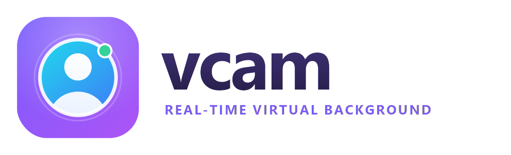

<p align="center">
  
</p>

# vcam — real-time webcam virtual background

Replace your real background in real time and expose the result as a **system
virtual camera** (the OBS Virtual Camera) that any app — Google Meet, Zoom,
Teams, Discord — can select like a normal webcam.

vcam uses **RobustVideoMatting (RVM)**, a real-time video matting model with
**temporal coherence** (recurrent state), so it holds up where lightweight
segmentation models tear: a **hand raised toward the camera**, fast motion, and
hair detail. It isolates a **single person**, keeps a clean edge with **no
halo**, and uses RVM's colour-decontaminated foreground so hair edges don't
bleed the old background.

100% local. No cloud, no account, no subscription. Written in Rust: one
self-contained Windows exe, no Python or other runtime needed.

---

## 1. Build

Needs [rustup](https://rustup.rs) and, on Windows, the Visual Studio C++ Build
Tools plus the Windows SDK.

```bash
cargo build --release      # -> target/release/vcam.exe (GUI) and vcam-cli.exe
```

The build downloads a static ONNX Runtime (CPU) and links it into the exe.
If `models/rvm_mobilenetv3_fp32.onnx` (PeterL1n's free, open-source model) is
present at build time it's **bundled into the exe**, so the exe needs no
internet; otherwise the exe downloads it on first run into
`%LOCALAPPDATA%\vcam\models`. To bundle it:

```bash
mkdir models
curl -L -o models/rvm_mobilenetv3_fp32.onnx \
  https://github.com/PeterL1n/RobustVideoMatting/releases/download/v1.0.0/rvm_mobilenetv3_fp32.onnx
```

`vcam.exe` runs on any **Windows 10/11 (64-bit)** PC — copy it and double-click.

### Virtual-camera backend (required to feed other apps)

vcam writes frames into the **OBS Virtual Camera** driver. Install
[OBS Studio](https://obsproject.com) (26.1+) once; the app's **Set up virtual
camera** button then registers the driver (Windows asks for admin). You do not
need OBS running.

> Without the driver, vcam still runs — the CLI shows a live **preview window**,
> it just won't appear as a camera in other apps.

---

## 2. Run

### Option A — the GUI (easiest)

Run `vcam.exe` (or `cargo run --release`). A control panel with the live
preview front and centre:

1. **One-time setup** — shown only if the "OBS Virtual Camera" isn't registered
   yet: one click registers it, or it links you to OBS Studio if the driver is
   missing and re-checks when you come back.
2. **Start / Stop camera** (Ctrl+Enter) — feeds the virtual camera; the preview
   shows a LIVE badge with fps. Problems appear as plain-language messages on
   the preview (hover for the technical detail).
3. **Camera** picker (by device name) and **Mirror image**.
4. **Background** — Original (no effect), Blur, Image, or Green screen —
   switchable live, with a blur-amount slider. Image opens a gallery: a
   built-in default plus any pictures you add (**+ Add**, Ctrl+O, or drag them
   onto the window; copied to
   `%APPDATA%\vcam\backgrounds`). Click one to use it, the ✕ that appears on
   hover (or Delete) to remove it (your original file is untouched), and optionally soften it. **Match my room
   (realistic)**, on by default, makes the picture read as the room the camera
   is filming: its light and colour follow your real room (measured behind
   you every frame), with a slight lens softness, your webcam's own grain, and
   a little of the background's light wrapping onto your edges.
5. **Advanced settings** — Performance (Sharp 720p / Smooth 30 fps), edge
   detail, only-one-person, and driver reinstall/uninstall.

Ctrl+B hides the controls so the preview gets the whole window. The window
follows the Windows light/dark theme, is DPI-aware, and remembers your
settings in `%APPDATA%\vcam\settings.json`.

`vcam.exe --selftest` exercises the engine without a camera or window and
writes the result to `vcam_selftest.txt`.

### Option B — the command line

```bash
# Virtual background from an image (the main use case)
vcam-cli --background office.png

# Blur your real background instead (also the default)
vcam-cli --blur

# Solid green screen (chroma key)
vcam-cli --color 0,177,64

# Headless: no preview window, just feed the virtual cam
vcam-cli --background office.png --no-preview
```

### Use it in Google Meet

1. Make sure **no other app is using the webcam** — a camera can only be owned
   by one app at a time. (If vcam says it can't open the camera, that's why.)
2. Start vcam and leave it running.
3. In Meet: **⋮ → Settings → Video → Camera → "OBS Virtual Camera"**.
   (Meet uses the *virtual* camera; vcam owns the *physical* one.)

Quit the CLI with **q** / **Esc** in the preview window, or **Ctrl+C** in the
terminal.

---

## 3. Options (CLI)

| Flag | Default | Description |
|------|---------|-------------|
| `--background, -b PATH` | — | Background image to composite behind you |
| `--blur` | — | Blur the real background instead of replacing it (default) |
| `--color R,G,B` | — | Solid color background, e.g. `0,177,64` |
| `--downsample` | `0.375` | RVM internal ratio 0–1; lower = faster, softer hair |
| `--threads` | `min(8,cores)` | CPU threads per RVM stage (more can be slower) |
| `--camera, -c N` | `0` | Webcam index (see `--list-cameras`) |
| `--width` / `--height` | `1280` / `720` | **Capture** resolution (what the camera is asked for) |
| `--out-width` / `--out-height` | = capture | **Output** resolution. Capture small/fast, upscale the result (see Performance) |
| `--fps` | `30` | Target frame rate |
| `--mirror` | off | Horizontally flip (selfie view) |
| `--auto-exposure` | off | Let the webcam's auto-exposure run (it can slow to ~20 fps in dim light; see Performance) |
| `--plain` | off | Paste the background picture as-is (default: match it to your room's light, focus and grain) |
| `--multi-person` | off | Keep everyone in frame (default: keep only the **single** largest person) |
| `--no-preview` | off | Don't open the preview window |
| `--no-virtualcam` | off | Preview only; don't open a virtual camera |
| `--list-cameras` | — | List the cameras and exit |

`VCAM_NATIVE_THREADS` sets the size of the pre/post-processing thread pool
(default 4); `VCAM_MODEL_DIR` makes vcam read and write its models only there.

---

## 4. How it works

```
webcam ─► Media Foundation ─► RVM (3-stage ONNX Runtime pipeline) ─► alpha + foreground
                                                                          │
                          background image / blur / color ────────────────┤
                                                                          ▼
                            composite ─► NV12 ─► OBS Virtual Camera ─► system camera
```

| Module | Does |
|--------|------|
| `capture` | Media Foundation source reader; picks the camera's best native format (size first, then fps, so 720p MJPEG@30 wins over YUY2@10) and decodes to RGB |
| `models` / `onnx_graph` | Finds or downloads RVM, and splits it into encoder / recurrent core / tail stage models by editing the ONNX protobuf directly |
| `rvm` | The 3-stage inference pipeline (one session + thread per stage) and the single-session fallback |
| `kernels` | Fused per-frame passes: input conversion, RVM's full-resolution guided-filter tail, single-person isolation, feather + blend |
| `compositor` / `imgproc` | Backgrounds (image cover-fit, blur, colour) and the resize/blur primitives |
| `look` | The realistic picture look: room light/colour matching, lens softness, webcam grain, light wrap |
| `pipeline` | Post-processing, compositing and the virtual-camera send on an output thread, overlapping the next inference |
| `virtualcam` | Writes the OBS Virtual Camera's `OBSVirtualCamVideo` shared-memory queue; registers/unregisters its driver |
| `worker` | The capture → matte → composite → send loop with live option changes, used by both the GUI and the CLI |

**RVM.** RobustVideoMatting is a recurrent video matting network: each frame
it consumes the previous frame's hidden state and emits a new one, so the
matte is **temporally coherent** — stable hair, hands, and edges under motion
instead of per-frame flicker. It also outputs a colour-decontaminated
foreground, so composited hair edges don't carry the old background's colour.

---

## 5. Performance

Frame rate is `min(camera fps, pipeline fps)`. On most webcams the **camera is
the ceiling**, not the matting.

Per frame, on the CPU:
- RVM runs as a **3-stage pipeline** (encoder | recurrent core | tail, split
  automatically at the recurrent state; one ONNX Runtime session + thread
  each), so consecutive frames are in different stages at once. ONNX Runtime
  stops scaling past ~8 threads on this model, so three sessions use a
  many-core CPU better, at the cost of two frames more latency;
- the model's last stage — upsampling the guided-filter coefficients and
  applying them at full resolution, ~20% of the network's time at 720p when
  ONNX Runtime does it — is one fused Rust pass on the output thread instead;
- post-processing (single-person isolation, compositing, NV12 conversion) runs
  on the output thread, overlapping the next inference;
- threads are capped to the fast cores (more threads *slow* this small
  recurrent net).

Measured on an i7-14700 at 720p / Balanced: the engine sustains ~32–36 fps;
the output is identical to the stock model to within float rounding (see the
`staged_matches_full_model` test).

**The camera** is a per-device **resolution/fps tradeoff**. vcam asks Media
Foundation for the camera's fastest format at the requested size, but some
webcams still do 1280×720 at only ~10–20 fps. Dim light is the usual culprit:
auto-exposure lengthens each exposure past the frame interval. So vcam fixes
the exposure at the longest that fits a frame (1/32 s at 30 fps) while it owns
the camera, and restores the camera's own setting afterwards — on a "Full HD
webcam" that took 720p from 20 to 30 fps. If the picture is too dark, add light
or turn this off (**Keep full frame rate in dim light** in Advanced settings,
`--auto-exposure` on the CLI). If the camera itself can't do 30 fps at 720p,
capture at a fast resolution and upscale the matted output:

```bash
vcam-cli --width 640 --height 360 --out-width 1280 --out-height 720
```

In the GUI this is the **"Smooth (30 fps)"** preset. The tradeoff is slightly
softer *source* detail; the matte itself stays sharp.

GPU execution providers are intentionally not used: at 720p the camera caps
fps anyway, and DirectML is known to mis-compute RVM's recurrent state on
Intel iGPUs.

---

## 6. Troubleshooting

- **"Can't access your webcam"** → another app owns the webcam (Meet/Zoom/Teams/
  OBS or another program). Close it, or pick a different camera.
- **"The virtual camera isn't set up yet"** → install OBS Studio, then use
  **Set up virtual camera**.
- **"already in use"** → OBS's own virtual camera (or another vcam) is running;
  stop it first.
- **Too slow** → lower the edge detail (`--downsample 0.3`), or use the Smooth
  preset / a lower capture resolution.
- **A second person/object shows up** → only the largest person is kept by
  default; turn off *Only show one person* (`--multi-person` keeps everyone).

---

## 7. Development

```bash
cargo test --release                       # unit tests
cargo test --release -- --include-ignored  # + the RVM parity test (needs the model)
```
